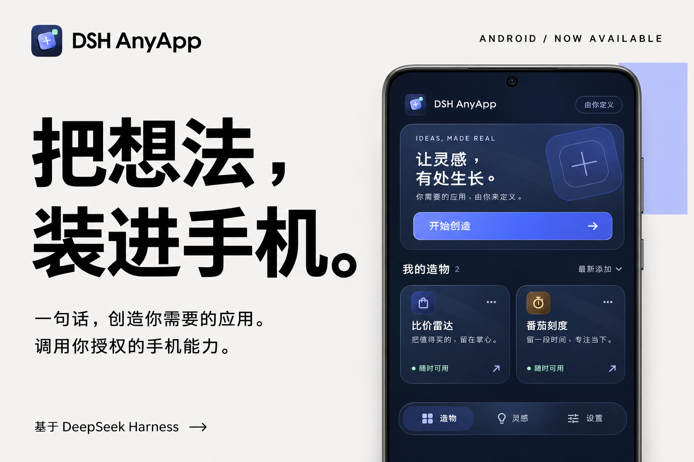
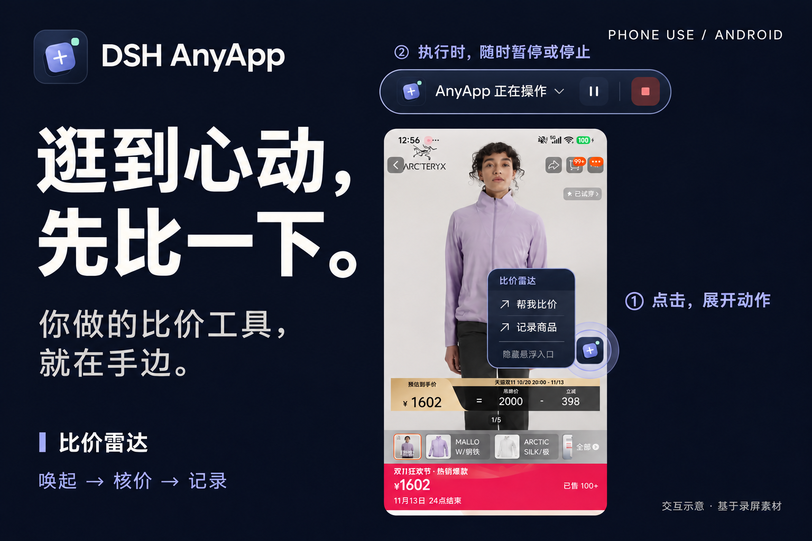
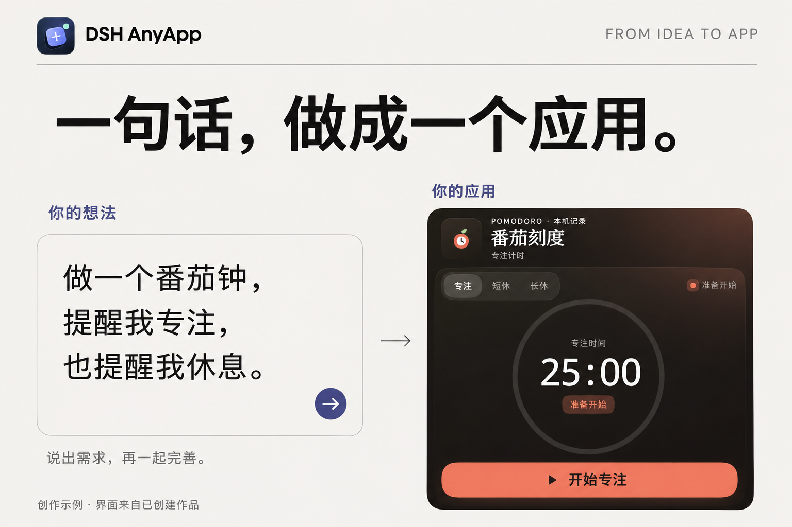

# DSH AnyApp 0.10.11

一句话，创造适合自己的 Android 小应用。

[下载 0.10.11 APK](https://github.com/jorylai/DSH-AnyApp/releases/download/v0.10.11/DSH-AnyApp-0.10.11-arm64.apk) · [发布说明与全部下载](https://github.com/jorylai/DSH-AnyApp/releases/latest) · [English](README.en.md)

基于真实 DeepSeek Harness Creator，可继续修改、导入和分享作品。首次安装自动准备比价雷达 1.25.0 与番茄钟。手机读屏、悬浮动作、提醒等能力由用户按需要开启。

## 从想法，到日常

**逛到心动，先比一下。** 比价雷达可以把常用动作放在悬浮入口；执行时，通过顶部控件随时暂停或停止。

**一句话，做成一个应用。** 说出需求，再一起完善；从一个番茄钟开始，也可以继续创造适合自己的工具。

[下载三张产品图原图（ZIP）](https://github.com/jorylai/DSH-AnyApp/releases/download/v0.10.11/DSH-AnyApp-Launch-Images-v3.zip) · [查看图片目录](docs/images/launch/README.md)

本项目是社区衍生项目，非 DeepSeek 官方产品。上游代码来源：ccch1mneyyy/dsh-go；遵循 AGPL-3.0 及各第三方组件许可，见 LICENSE、THIRD_PARTY_NOTICES.md、ASSETS.md。

## 致谢

特别感谢 [DSH Go](https://github.com/ccch1mneyyy/dsh-go) 及其作者与贡献者。这个产品给了我们很大的启发：它让我们看到了在 Android 上安装、运行 DeepSeek Harness 的可行路径，也展示了如何连接无障碍、悬浮窗、后台运行等手机系统能力。这些探索和开源工作，是 DSH AnyApp 得以继续尝试「让每个人用一句话创造自己的应用」的重要起点。

DSH AnyApp 在这一基础上继续探索作品创作、分享与日常使用体验。感谢前人的认真探索，也希望我们的工作能为后来的创作者提供一些新的可能。项目独立维护；上述致谢不代表上游为本项目背书。

## 安装

选择 DSH-AnyApp-0.10.11-arm64.apk，适用 Android 8 及以上 ARM64 手机。包名 app.dshwish，与此前正式包签名一致；已有用户覆盖安装，不要卸载或清除数据。测试版 app.dshwish.fresh 有独立数据空间。手机会按系统规则提示安装与授权。

这次发布更新预装比价雷达，保留作者提供的代码、名称和图标。旧作品和记录不会因预装更新被覆盖。导入作品的继续创作、权限页面整合、悬浮入口引导等修复也包含在此版本。

## 构建

- Flutter 3.47.9 / Dart 3.13.7，JDK 17，Android SDK 36。
- `app` 为 Flutter 应用；`packages` 为本地 Dart 库；`runtime` 包含 Linux 运行时构建脚本、锁文件和 DSH 补丁；`products/radar-release` 为此次预装作品。
- 运行时按 `runtime/build-runtime.sh` 在 Linux 构建 ARM64 产物，放入 `runtime/out/arm64-v8a`。版本及输入校验见脚本、`runtime/locks` 和 `runtime/patches/pins.json`。
- `cd app && flutter pub get`，再从根目录执行 `bash tooling/build-apk.sh --build-name 0.10.11`。
- 本源码不含开发者私钥、签名密码、本地路径配置或登录态。自行构建使用自己的签名；自己的签名不能覆盖官方分发包。
- `node products/radar-release/build.mjs` 可重建雷达预置资源。

## 当前边界

安装包采用 targetSdk 28 以支持现有本地 Linux 执行架构，不是 Google Play 提交包。公开分发与应用市场审核为不同事项。手机授权和应用商店政策仍适用。

本次新增的预装包已通过导入、隔离、名称图标和空初始记录检查，安装包已核对签名、完整性及预装资源。完整真机回归尚未完成；网页／自动测试不等同于实际跨应用比价成功。

## 版本更新

后续版本统一发布到本仓库的 Releases。正式安装包使用相同包名及签名，下载后覆盖安装即可保留应用数据；测试包使用独立身份。本版尚未启用应用内自动更新，请从[发布页](https://github.com/jorylai/DSH-AnyApp/releases/latest)检查新版本。不要安装来源不明或签名不同的替代包。
